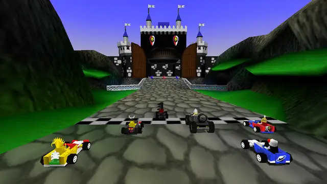
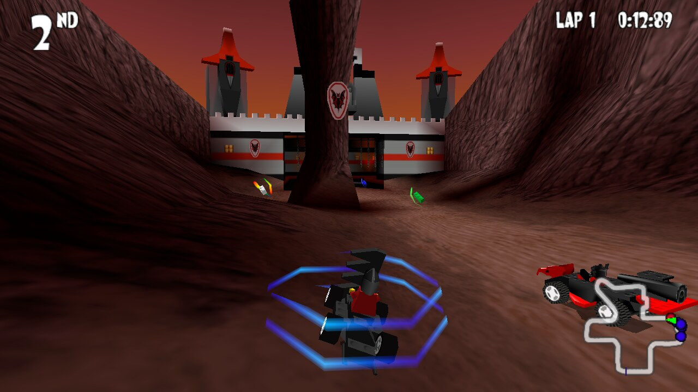
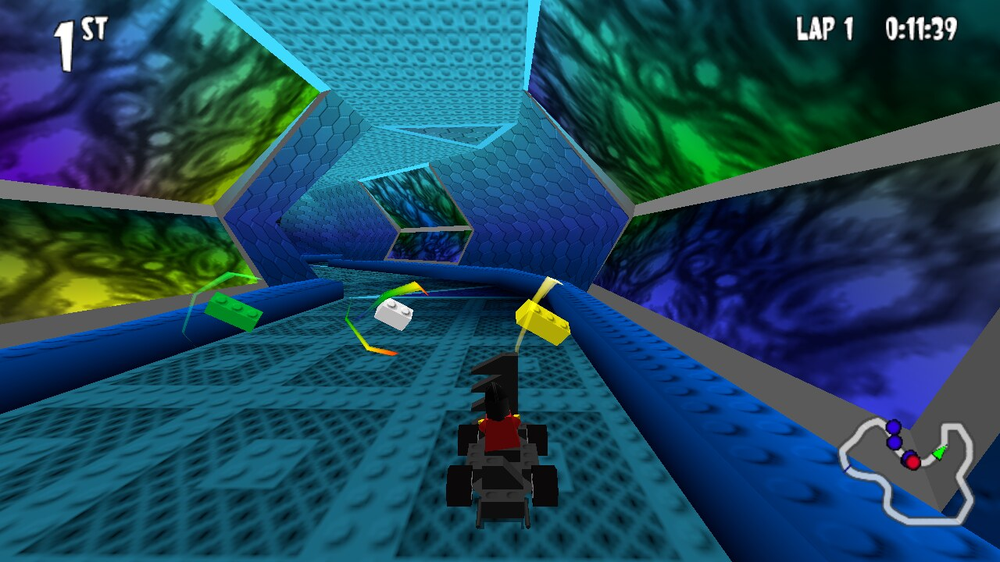
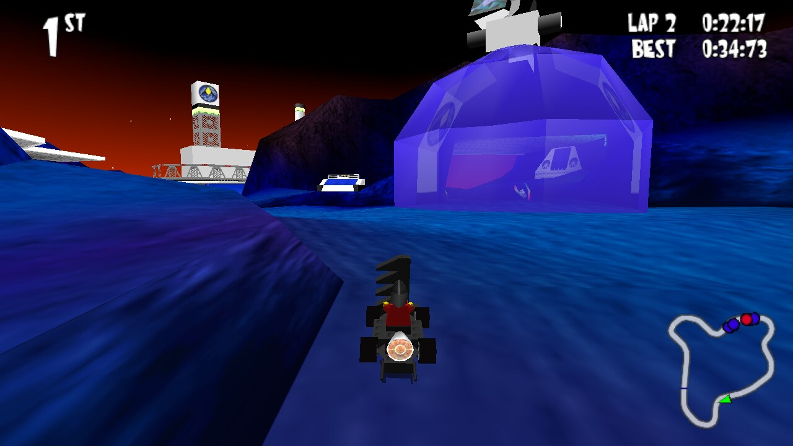
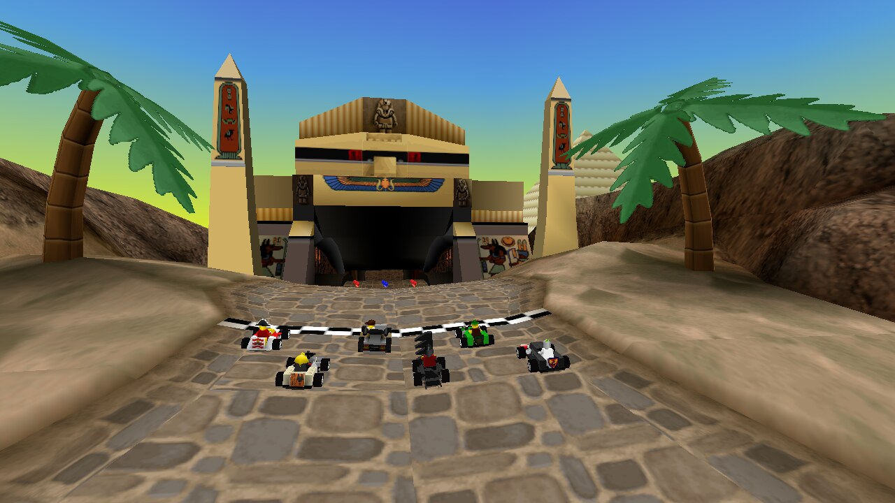
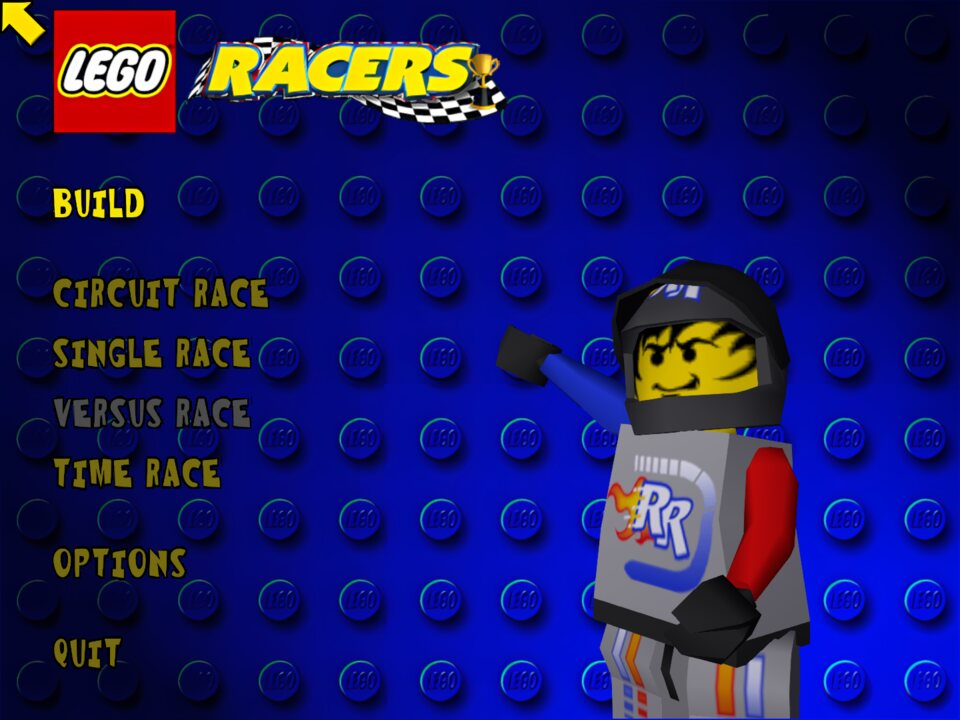
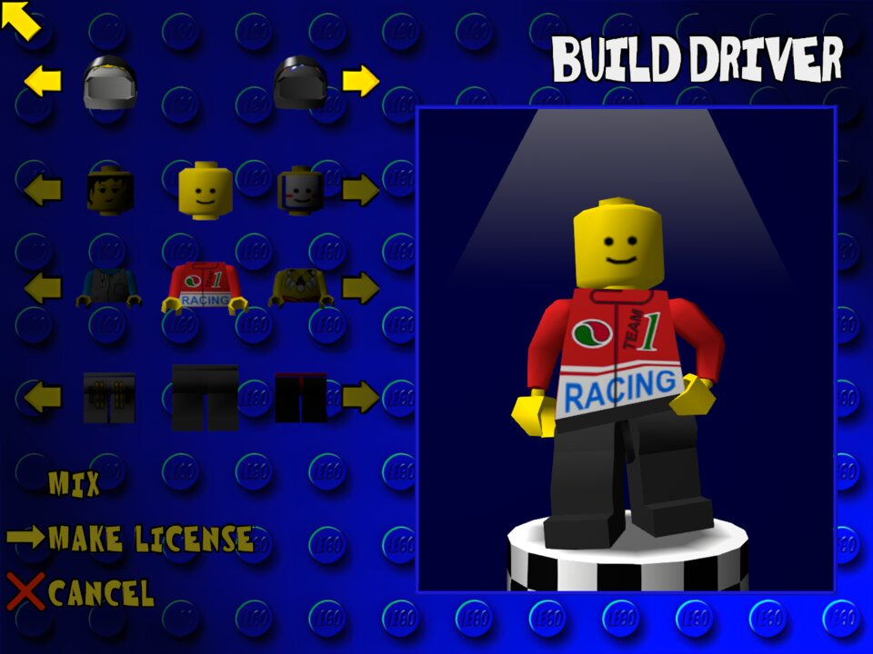

<h1 align="center">LEGO Racers — UE5</h1>

<p align="center"><b>The 1999 classic, rebuilt in Unreal Engine 5.</b><br>
The original game's races, handling and menus, on a new engine.</p>

<p align="center"></p>

<p align="center">
<a href="https://github.com/zmelumian972/LRUE5/releases/latest/download/LegoRacers-Windows.zip"><b>Windows</b></a> ·
<a href="https://github.com/zmelumian972/LRUE5/releases/latest/download/LegoRacers-Linux.tar.gz"><b>Linux</b></a> ·
<a href="https://github.com/zmelumian972/LRUE5/releases/latest/download/LegoRacers-Thor.tar.gz"><b>AYN Thor</b></a> ·
<a href="https://github.com/zmelumian972/LRUE5/releases">All releases</a>
</p>

> [!WARNING]
> **Alpha: experimental.** The whole game is playable, but expect bugs, crashes and visual glitches, and saves
> that may not carry over between versions. Tested so far: Linux on a desktop
> PC and the AYN Thor; the Windows build hasn't been played on real hardware yet. Reports are welcome in
> [Issues](https://github.com/zmelumian972/LRUE5/issues).

## What is this?

LEGO Racers on Unreal Engine 5. The game's logic is a new implementation, built on what the community's
reverse-engineering of the original learned (see [Credits](#credits)), and tested so that the karts' handling, the
AI's racing and the power-ups stay as they were in 1999. Unreal Engine 5 draws it, plays its sound and reads your
controller. Everything it shows and plays comes from your own copy of the game.

## Features

- **The whole game.** Circuit, single, time and two-player Versus races; the driver, car and license builders; every
  track, power-up and hazard; saves.
- **Smooth at any frame rate.** The game runs at its original 62.5 Hz; above that, frame smoothing draws every frame
  in between.
- **Widescreen**, gamepads with rumble, and the whole keyboard for rebinding controls.
- **Video settings** in the game's own style: OPTIONS > VIDEO OPTIONS, or Esc during a race.

## Gallery

<table>
<tr>
<td width="50%"></td>
<td width="50%"></td>
</tr>
<tr>
<td width="50%"></td>
<td width="50%"></td>
</tr>
<tr>
<td width="50%"></td>
<td width="50%"></td>
</tr>
</table>

## How to play

You need your own copy of **LEGO Racers (1999)**, installed. No original game files come with these builds: the game
reads everything (models, textures, sounds, music) from your install.

1. Download the build for your platform (links above; always the latest), or any version from [Releases](https://github.com/zmelumian972/LRUE5/releases).
2. Extract it and run the game.
3. On first launch, select `LEGO.JAM` in your LEGO Racers folder (`LEGORacers.exe` has to be next to it). The game
   remembers the folder and prepares its data from it once, behind a progress screen; nothing is copied. No file dialog on
   your system (e.g. a handheld's game mode)? Copy that folder's files into `LegoRacers/GameData/` yourself.

| Platform | Download (latest) | Run |
|---|---|---|
| Windows (x64) | [LegoRacers-Windows.zip](https://github.com/zmelumian972/LRUE5/releases/latest/download/LegoRacers-Windows.zip) | `LegoRacers.exe` |
| Linux (x86-64) | [LegoRacers-Linux.tar.gz](https://github.com/zmelumian972/LRUE5/releases/latest/download/LegoRacers-Linux.tar.gz) | `./LegoRacers.sh` |
| AYN Thor (Linux, ARM64) | [LegoRacers-Thor.tar.gz](https://github.com/zmelumian972/LRUE5/releases/latest/download/LegoRacers-Thor.tar.gz) | `./LegoRacers-Arm64.sh -nosplash` |

On Windows, if it says `VCRUNTIME140.dll` or `MSVCP140.dll` is missing, install Microsoft's
[Visual C++ Redistributable (x64)](https://aka.ms/vs/17/release/vc_redist.x64.exe).

The game knows the release of `LEGORacers.exe` it was made from; another version shows a message saying so.

## Build from source

You need [Unreal Engine 5.8](https://www.unrealengine.com) on Linux (the scripts are Linux only; the engine isn't part of this
repository), and your own copy of the game to play what you build.

```bash
export UE_ROOT=<your Unreal Engine folder>
scripts/build.sh             # the editor target, the game included (log: build/ubt.log)
scripts/package.sh           # a packaged build: build/package/Linux/
scripts/package.sh --share   # the same, archived to give to others: build/share/
```

The first package is slow: the cook compiles shaders. The source's layers are `Source/LRData` (reads the game's file
formats), `Source/LRCore` (the whole game, plain C++ with no Unreal headers) and `Source/LegoRacers` (Unreal Engine draws
it and plays its sound). A development build also looks for the install in `$LR_GAME_DIR`.

## License

The code in this repository is under the [MIT License](LICENSE). It covers this project's own code only: not LEGO Racers,
its content or its trademarks, and not Unreal Engine, which has its own license from Epic Games.

## Credits

- **LEGO Racers** (1999) was developed by **High Voltage Software** and published by **LEGO Media International**.
  The game, its content and its design belong to the LEGO Group. Thank you for one of the best racers of its time.
- **[isledecomp/racers](https://github.com/isledecomp/racers)**, the community's decompilation of LEGO Racers. Much
  of how the original works, from the karts' physics and steering to many of its values, was learned from their work.
  Thank you.
- **[Unreal Engine 5](https://www.unrealengine.com)** by **Epic Games**. This project uses the Unreal® Engine. Unreal® is
  a trademark or registered trademark of Epic Games, Inc. in the United States of America and elsewhere.
  Unreal® Engine, Copyright 1998 – 2026, Epic Games, Inc. All rights reserved.

LEGO and LEGO Racers are trademarks of the LEGO Group. This is a fan project, not affiliated with, endorsed or
sponsored by the LEGO Group, High Voltage Software or Epic Games.
