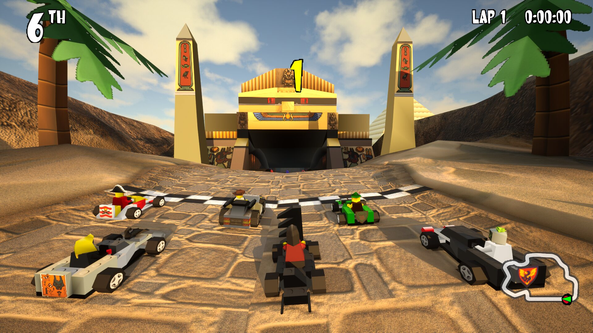
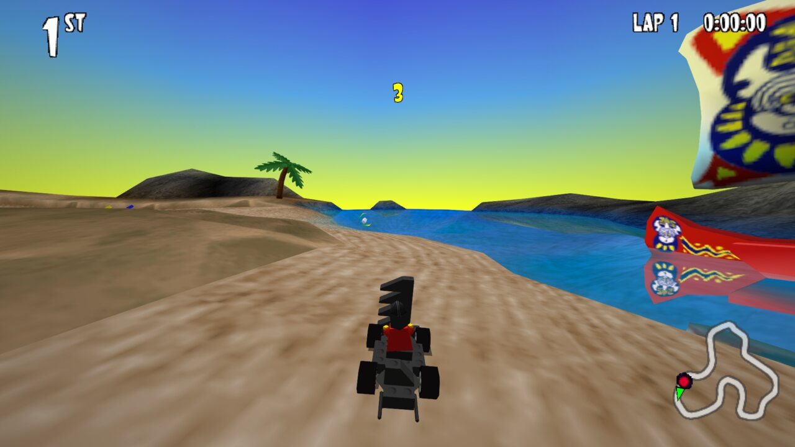
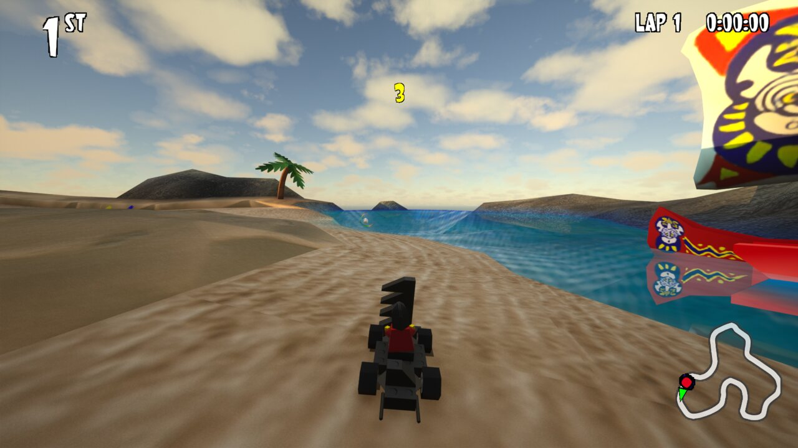
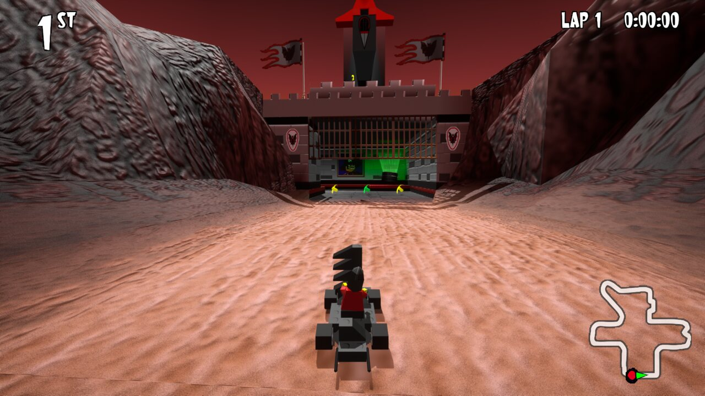
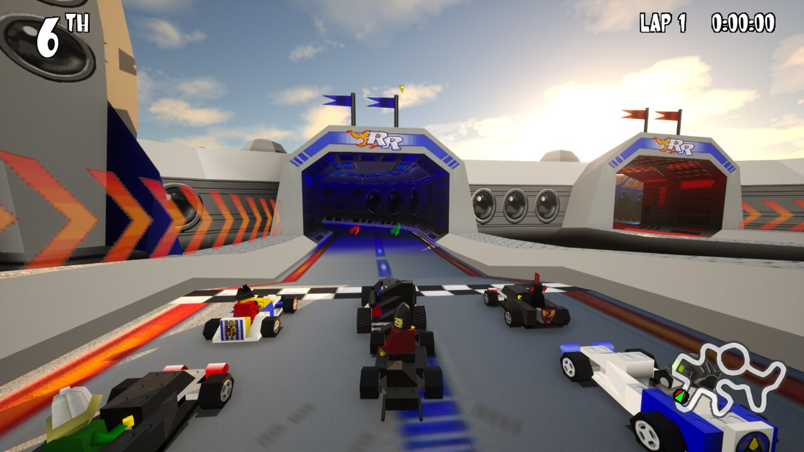
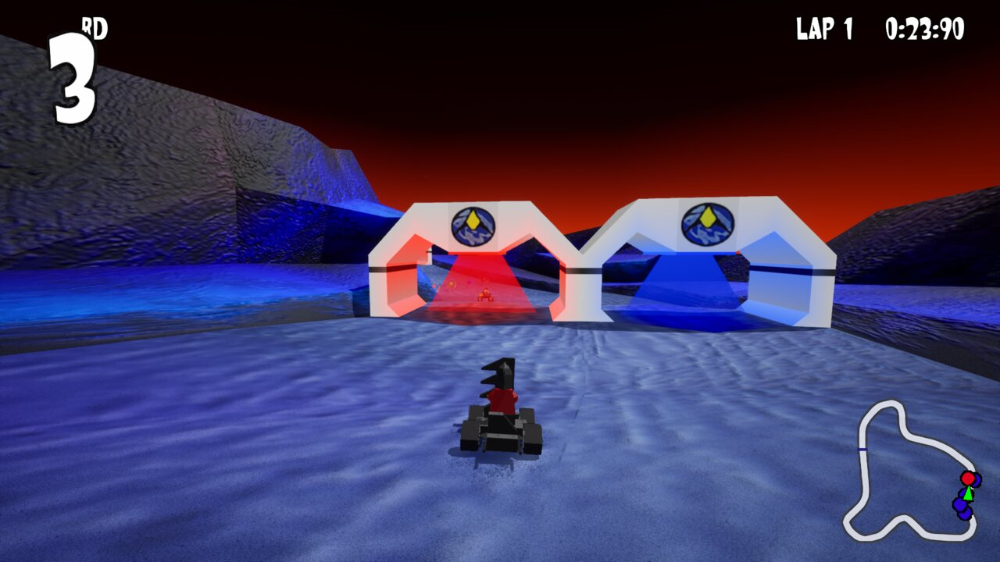
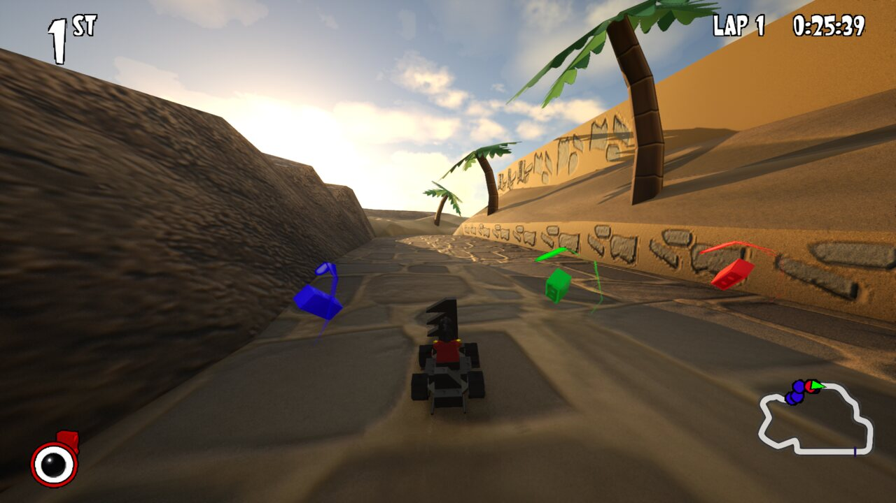
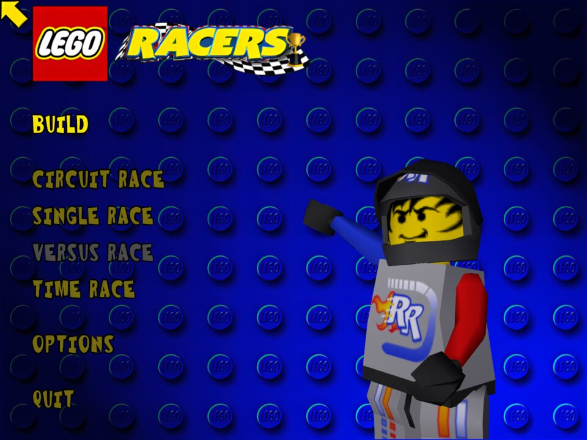
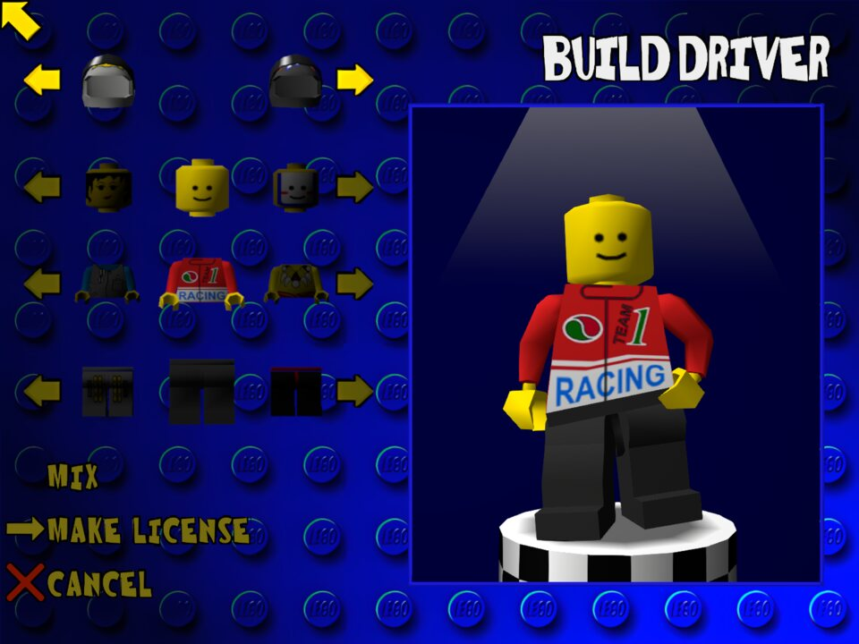

<h1 align="center">LEGO Racers — UE5</h1>

<b>The 1999 classic, rebuilt in Unreal Engine 5.</b> 
The original game's races, handling and menus, with a modern coat of paint.

<a href="https://github.com/zmelumian972/LRUE5/releases/latest/download/LegoRacers-Windows.zip"><b>Windows</b></a> ·
<a href="https://github.com/zmelumian972/LRUE5/releases/latest/download/LegoRacers-Linux.tar.gz"><b>Linux</b></a> ·
<a href="https://github.com/zmelumian972/LRUE5/releases/latest/download/LegoRacers-Thor.tar.gz"><b>AYN Thor</b></a> ·
<a href="../../releases">All releases</a>

> [!WARNING]
> **Alpha: experimental.** The whole game is playable, but expect bugs, crashes and visual glitches, and saves
> that may not carry over between versions. The Modern look is still changing. Tested so far: Linux on a desktop
> PC; the Windows and AYN Thor builds haven't been played on real hardware yet. Reports are welcome in
> [Issues](../../issues).

## What is this?

LEGO Racers on Unreal Engine 5. It isn't a remake built to look like the original: the game underneath is the original
game's own logic, carried over from the community's decompilation of it, so the karts handle, the AI races and the
power-ups behave exactly as they did in 1999. Unreal Engine 5 draws it, plays its sound and reads your controller.

That gives you the same game in two looks, switched any time with **F9**:

<table>
<tr>
<td width="50%"></td>
<td width="50%"></td>
</tr>
<tr>
<td align="center"><b>Classic</b>: the original's pixels and lighting</td>
<td align="center"><b>Modern</b>: real-time lighting, sky and HD textures</td>
</tr>
</table>

## Features

- **The whole game.** Circuit, single, time and two-player Versus races; the driver, car and license builders; every
  track, power-up and hazard; saves.
- **Modern look.** Lumen global illumination, a physical sky with clouds and a low golden-hour sun on daytime tracks,
  glossy LEGO plastic, reflective water, relief on the tracks, tire tracks in the sand, glowing effects.
- **HD textures.** Every track's and menu's textures upscaled 4× (Modern; Classic keeps the original pixels).
- **Smooth at any frame rate.** The game runs at its original 62.5 Hz; above that, frame smoothing draws every frame
  in between.
- **Widescreen**, gamepads with rumble, and the whole keyboard for rebinding controls.
- **Video settings** in the game's own style: OPTIONS > VIDEO OPTIONS, or Esc during a race.

## Gallery

<table>
<tr>
<td width="50%"></td>
<td width="50%"></td>
</tr>
<tr>
<td width="50%"></td>
<td width="50%"></td>
</tr>
<tr>
<td width="50%"></td>
<td width="50%"></td>
</tr>
</table>

## How to play

You need your own copy of **LEGO Racers (1999)**. No original game files come with these builds: the music and HD
textures are included but locked, and open only with the `LEGO.JAM` file from your own install.

1. Download the build for your platform (links above; always the latest), or any version from [Releases](../../releases).
2. Extract it and run the game.
3. On first launch, choose `LEGO.JAM` from your LEGO Racers folder (next to `LEGORacers.exe`). It's copied into
   `LegoRacers/GameData/`, so you're only asked once. No file dialog on your system (e.g. a handheld's game mode)?
   Copy `LEGO.JAM` into `LegoRacers/GameData/` yourself.

| Platform | Download (latest) | Run |
|---|---|---|
| Windows (x64) | [LegoRacers-Windows.zip](https://github.com/zmelumian972/LRUE5/releases/latest/download/LegoRacers-Windows.zip) | `LegoRacers.exe` |
| Linux (x86-64) | [LegoRacers-Linux.tar.gz](https://github.com/zmelumian972/LRUE5/releases/latest/download/LegoRacers-Linux.tar.gz) | `./LegoRacers.sh` |
| AYN Thor (Linux, ARM64) | [LegoRacers-Thor.tar.gz](https://github.com/zmelumian972/LRUE5/releases/latest/download/LegoRacers-Thor.tar.gz) | `./LegoRacers-Arm64.sh -nosplash` |

On Windows, if it says `VCRUNTIME140.dll` or `MSVCP140.dll` is missing, install Microsoft's
[Visual C++ Redistributable (x64)](https://aka.ms/vs/17/release/vc_redist.x64.exe).

Only the release of `LEGO.JAM` these builds were made from unlocks them; another version or language of the game shows
a message saying so.

## Credits

- **LEGO Racers** (1999) was developed by **High Voltage Software** and published by **LEGO Media International**.
  The game, its content and its design belong to the LEGO Group. Thank you for one of the best racers of its time.
- The game logic comes from the **[isledecomp](https://github.com/isledecomp)** community's decompilation of LEGO
  Racers, [racers](https://github.com/isledecomp/racers) and [racers-portable](https://github.com/isledecomp/racers-portable).
  None of this would exist without their work.
- **[Unreal Engine 5](https://www.unrealengine.com)** by **Epic Games**. This project uses the Unreal® Engine. Unreal® is
  a trademark or registered trademark of Epic Games, Inc. in the United States of America and elsewhere.
  Unreal® Engine, Copyright 1998 – 2026, Epic Games, Inc. All rights reserved.
- HD textures upscaled with **[Real-ESRGAN](https://github.com/xinntao/Real-ESRGAN)** by Xintao Wang et al.

LEGO and LEGO Racers are trademarks of the LEGO Group. This is a fan project, not affiliated with, endorsed or
sponsored by the LEGO Group, High Voltage Software or Epic Games.
